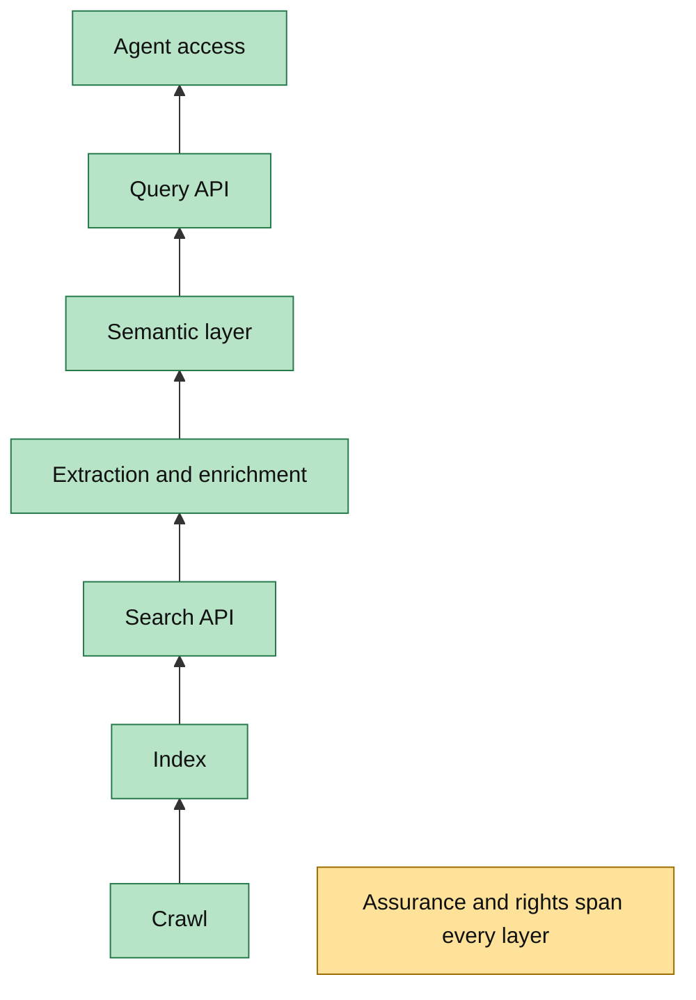
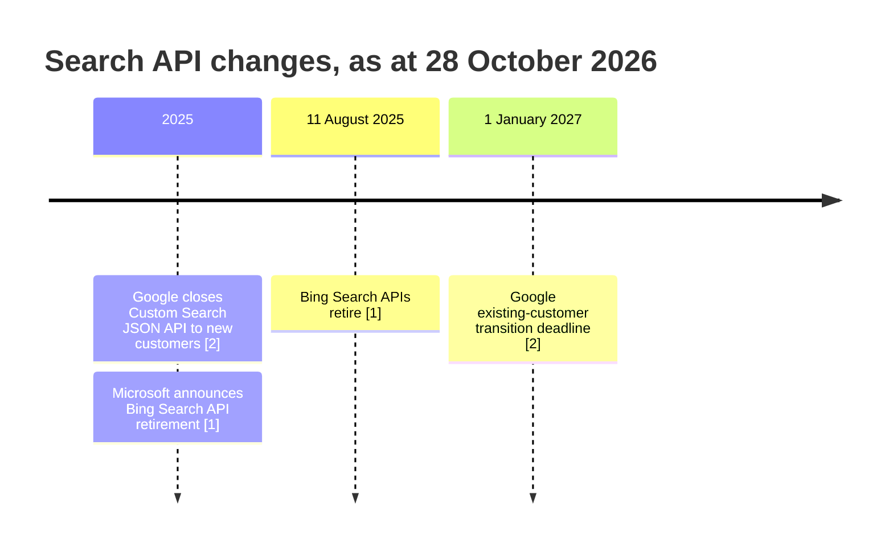
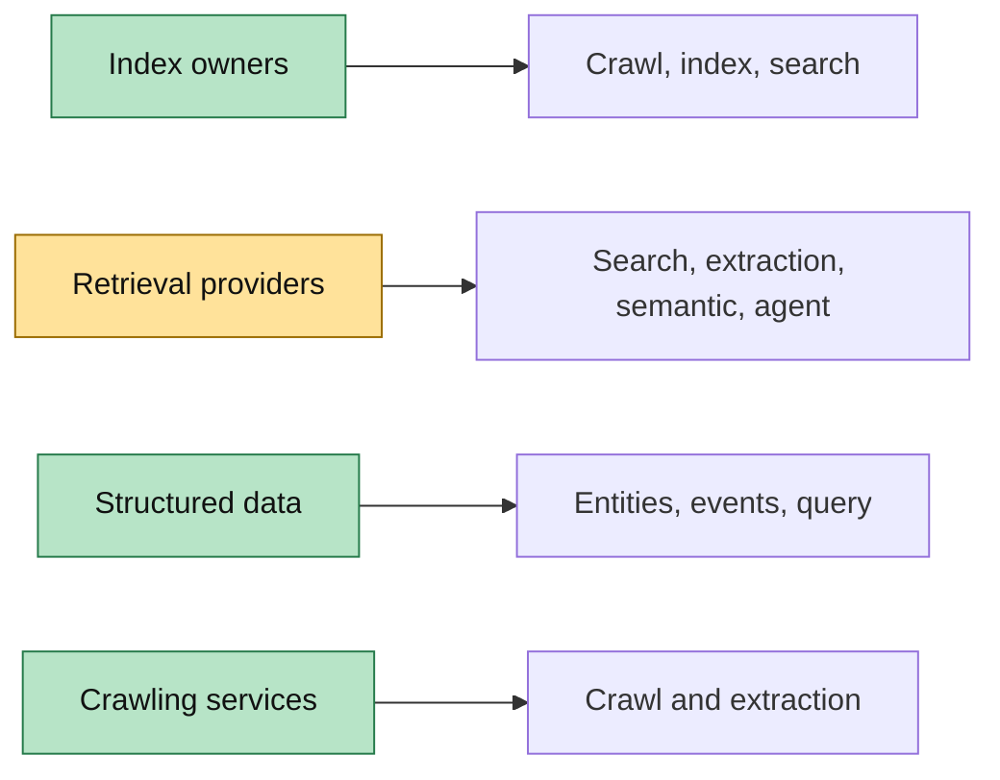
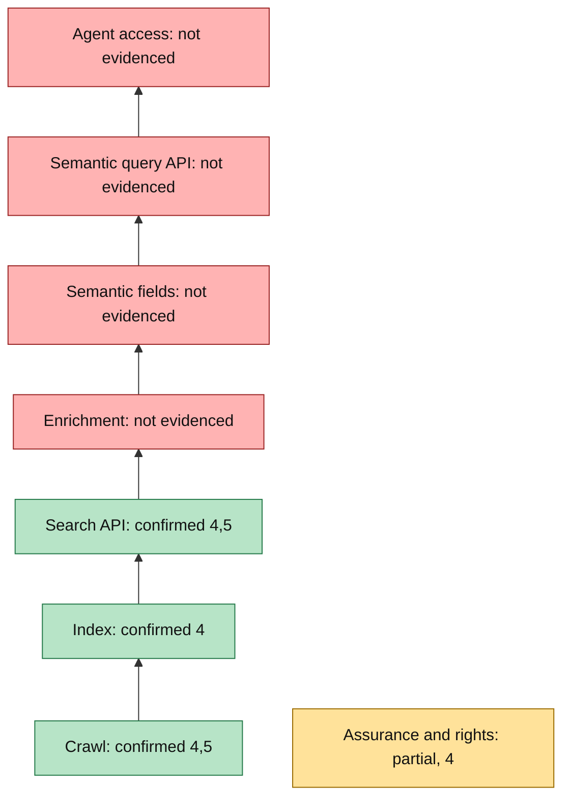

# Search Index and Retrieval API Market Map

**Research lead and author:** Jonny Bowker, Managing Director, Advanced Analytica Ltd  
**Research assistant:** Codex  
**Date:** 28 October 2026  
**Scope:** Public web crawl, index, retrieval, enrichment, semantic access, agent access, assurance and rights.  
**Limits:** This study uses public evidence. It doesn't include private contracts, internal systems or buyer interviews. It is not financial, legal or investment advice.

## 1. Decision summary

### Verdict

**Confirmed.** The market has separated into distinct layers. Few suppliers control a general web crawl and index. Many suppliers package search, extraction and model-ready context above an index. Google and Microsoft have reduced open, general search API access. Their published notices direct users towards bounded search or grounded agent products [1][2].

**Confirmed.** Independent index ownership is scarce and strategically distinct from retrieval packaging. Brave states that it crawls, ranks and serves its own index [3]. Mojeek publishes an API over its own web index [4]. Common Crawl publishes recurring crawl files and capture indexes, but not a ranked public search service [12][13].

**Confirmed.** Value above a plain search API comes from clean content, entities, filters, ranking, citations and agent interfaces. Webz.io returns structured news fields, entities and sentiment [10]. GDELT publishes event and knowledge-graph data [11]. Jina publishes reading, search, embedding and reranking endpoints [9].

**Unconfirmed.** Public evidence doesn't show a comparable revenue market for each layer. Definitions differ across web search, scraping, enterprise search and AI grounding. This paper doesn't combine those figures. It also doesn't prove buyer demand for a new Mojeek layer. The personas are interview hypotheses only.

### Findings that drive the decision

1. **Confirmed.** Microsoft retired Bing Search APIs on 11 August 2025. It directed customers to Grounding with Bing Search [1].
2. **Confirmed.** Google closed Custom Search JSON API to new customers. Existing users have a 1 January 2027 transition deadline [2].
3. **Confirmed.** A plain ranked result is no longer the complete agent requirement. Current products expose extracted text, chunks, entities, filters and direct agent tools [6][7][8][9][10].
4. **Unverified.** Mojeek may provide a base for higher layers. Public evidence confirms crawl, index and search API access. It doesn't establish entity data, stored vectors, a semantic query service or MCP access [4][5].

### Confirmed and unconfirmed split

| Confirmed from public evidence | Not confirmed from public evidence |
|---|---|
| Bing API retirement and replacement direction [1] | Microsoft's commercial motive |
| Google API closure and transition date [2] | Google's commercial motive |
| Brave claims an independent index [3] | Independent audit of Brave's coverage |
| Mojeek returns URLs, titles and snippets [4] | Mojeek entity store or vector store |
| Common Crawl publishes crawl data and indexes [12][13] | A ranked Common Crawl search service |
| Retrieval vendors expose model-ready content [6][7][9] | Which upstream index every vendor uses |
| Structured providers add entities and events [10][11][15] | A comparable revenue total for every layer |

The active-role proposal in Part Two depends on direct diligence. It should proceed only if lineage, rights and buyer evidence pass defined gates.

## Part One. Neutral landscape study

## 2. The stack

The market is easier to read as a chain. Ownership changes at each boundary. A provider may operate one layer, combine several, or buy an upstream feed.

1. **Crawl.** Software discovers and fetches pages. Evidence includes the user-agent, robots rules, rate controls and fetch scale.
2. **Index.** Systems deduplicate, filter and store fetched material. An index may support ranked search, datasets or specialist link analysis.
3. **Search API.** A request returns ranked URLs, titles and snippets. Filters often cover language, country, domain and date.
4. **Extraction and enrichment.** Page content becomes clean text or structured fields. Entities, dates, locations and sentiment appear here.
5. **Semantic layer.** Chunks and embeddings support retrieval by meaning. Query and document vectors must share a compatible model space.
6. **Query API.** An application filters and retrieves semantic or structured records. REST dominates the reviewed public interfaces.
7. **Agent access.** MCP or a similar tool protocol lets an agent invoke retrieval without custom connector code.
8. **Assurance and rights.** Security scope, provenance, retention, publisher rights and audit evidence apply across the chain.

**Confirmed.** Common Crawl shows why crawl and index aren't identical to ranked search. It publishes WARC responses, WAT metadata, WET text and capture indexes [12][13]. A customer must still build ranking, extraction and serving.

**Confirmed.** Jina shows how layers can remain modular. Its public interface separates Reader, Search, embeddings and reranking [9]. A buyer can use one component without adopting the entire chain.

**Figure 1. The eight-layer stack, as at 28 October 2026. Green means confirmed. Amber means cross-cutting or incomplete. Red means absent.**

Plain text: data moves from fetching to storage, ranked retrieval, enrichment, semantic retrieval and agent tools. Assurance spans every step.

## 3. Why Google and Bing are closing their APIs

### What happened

**Confirmed.** Microsoft announced that Bing Search APIs would retire on 11 August 2025. Existing instances would be decommissioned and new sign-up would end [1]. Microsoft recommended Grounding with Bing Search within Azure AI Agents [1].

**Confirmed.** Google's documentation states that Custom Search JSON API is closed to new customers. Existing customers must move by 1 January 2027 [2]. Google points bounded searches towards Vertex AI Search and asks full-web users to register interest [2].

**Figure 2. Published withdrawal milestones.** Plain text: both suppliers restricted general API access during 2025. Google's final transition date follows in 2027.

### Hypotheses tested

**Unverified.** Neither notice says that the supplier wants to prevent third parties from using its index. That hypothesis remains plausible, but the notices don't prove it [1][2].

**Reported inference.** Both replacement routes keep retrieval close to the supplier's AI platform. Microsoft names Azure AI Agents. Google names Vertex AI Search for bounded domains [1][2]. This supports a product-integration explanation. It doesn't establish motive.

**Unverified.** Serving costs, competing AI products, publisher pressure and regulatory exposure may affect the decision. No reviewed primary source assigns a causal weight to them. Ordinary portfolio simplification is also possible.

### Conclusion

The evidence proves product withdrawal and platform-directed replacements. It doesn't prove a single commercial reason. The practical result is clear. Developers lost two broad routes to established web indexes. Independent indexes and retrieval intermediaries gained relevance.

## 4. The market by category

### 4.1 Index owners and public datasets

**Confirmed.** Google and Bing operate major public search engines. Their general developer routes are now restricted as described above [1][2]. This study doesn't treat consumer search access as reusable API access.

**Confirmed to provider documentation.** Brave says every API result comes from its independent index. It publishes web, news, image, video, places and model-context endpoints [3]. The claim is a provider statement, not an external coverage audit.

**Confirmed to provider documentation.** Mojeek offers web search over an index of billions of pages. Its public response is URL, title and query-dependent snippet [4]. Optional fields include recognised modification date and last crawl date [5].

**Confirmed.** Common Crawl is a non-profit dataset operator. It publishes roughly monthly crawls, WARC records and URL indexes [12][13]. It is infrastructure for builders, not a ready ranked-search substitute.

**Unverified in this study.** Yandex, Baidu, Naver and Seznam operate regional engines. Their current developer access, crawler policy and hosting details need language-specific review. They remain in the crawler register as diligence targets.

**Unresolved.** Marginalia provides a small-web search service. Public evidence needs a separate technical review before its index scale or API status can enter the matrix.

### 4.2 Retrieval layers for AI agents

**Confirmed to documentation.** Tavily packages search, extraction, research, crawl and site mapping [7]. Its MCP connector exposes those functions as agent tools [8]. Public materials reviewed here don't establish full ownership of its upstream web index.

**Confirmed to documentation.** Exa's published OpenAPI describes embeddings-based and traditional search. The request can return text, summaries, subpages, links and images [6]. Its claim of internet-scale search doesn't disclose every upstream data dependency.

**Confirmed to documentation.** Jina returns searched pages as model-friendly text. It also publishes embedding and reranking endpoints [9]. Its search interface can select providers, so it shouldn't be classified as a sole independent index owner [9].

**Confirmed to documentation.** Perplexity's Sonar interface returns grounded answers. It sits at query and answer level, not as a documented general index export [17].

**Unverified in this study.** You.com and Kagi offer developer products, but their current upstream dependencies weren't established from opened primary pages. They remain retrieval providers with ownership marked unknown.

### 4.3 Structured web data and entities

**Confirmed to documentation.** Diffbot describes its Knowledge Graph as an entity database [15]. It converts pages into linked company, person, product and event records. That is different from returning ten ranked links.

**Confirmed to documentation.** Webz.io returns structured news JSON. Fields include entities, sentiment, source details, syndication and engagement [10]. Buyers receive monitoring-ready records and filters.

**Confirmed.** GDELT publishes events and a Global Knowledge Graph. Version 2 updates every 15 minutes and covers people, locations, themes, emotions and sources [11]. It is a public research substrate, not a supported enterprise search contract.

### 4.4 Crawling and extraction services

**Confirmed to documentation.** Firecrawl turns websites into model-ready markdown or structured data [16]. Apify provides a platform for running web scrapers [18]. They help customers acquire content from nominated sites.

**Unverified in this study.** Zyte, Bright Data and Oxylabs are established crawling vendors. Their exact robots, proxy, retention and rights positions require contract-level review. Scrapy is an open-source framework associated with Zyte, but framework authorship isn't index ownership.

### 4.5 Crawler register

| Operator | Crawler or service | Own crawler/index | Country or hosting | Status and feed | Evidence status |
|---|---|---|---|---|---|
| Google LLC | Googlebot | Own crawl and search index | US | Active, public search | Confirmed, detailed policy not reviewed |
| Microsoft Corporation | Bingbot | Own crawl and search index | US | Active, public search; API retired [1] | Confirmed [1] |
| Brave Software, Inc. | Brave crawler | Claims own index | US | Active, search and API | Confirmed to provider [3] |
| Mojeek Limited | MojeekBot | Claims own index | UK | Active, search and API | Confirmed to provider [4][5] |
| Common Crawl Foundation | CCBot | Own public crawl dataset | AWS us-east-1 [12] | Active, datasets | Confirmed [12] |
| Yandex LLC | YandexBot | Own search index | Not reviewed | Active, regional search | Unverified here |
| Baidu, Inc. | Baiduspider | Own search index | Not reviewed | Active, regional search | Unverified here |
| NAVER Corporation | Yeti | Own search index | Not reviewed | Active, regional search | Unverified here |
| Seznam.cz, a.s. | SeznamBot | Own search index | Not reviewed | Active, regional search | Unverified here |
| Marginalia Search | Marginalia crawler | Specialist index | Not reviewed | Active status requires check | Unverified here |
| Dassault Systèmes | Exalead | Historic web and enterprise search | France | Current web index status unclear | Unresolved |
| Ahrefs Pte. Ltd. | AhrefsBot | Link and SEO index | Not reviewed | Active, SEO data | Unverified here |
| Majestic-12 Ltd | MJ12bot | Link index | UK | Active, SEO data | Unverified here |
| Semrush Inc. | SemrushBot | SEO crawl | US | Active, SEO data | Unverified here |
| Moz, Inc. | rogerbot or DotBot | Link index | US | Current identity requires check | Unresolved |
| Brandwatch | Linkdex history | Historical SEO product | UK | Acquired or rebranded status unclear | Unresolved |
| OpenAI | GPTBot | AI collection crawler | US | Active policy requires review | Unverified here |
| Anthropic PBC | ClaudeBot | AI collection crawler | US | Active policy requires review | Unverified here |
| Perplexity AI, Inc. | PerplexityBot | AI search crawler | US | Active policy requires review | Unverified here |

**Unresolved.** The claim that Linkdex used Mojeek wasn't confirmed in opened primary material. Evidence that would settle it includes a contract, archived technical page, named company statement or crawler logs linked to both parties.

## 5. Provider profiles

**Google. Confirmed.** It retains consumer search and Programmable Search Engine. Its JSON API is closed to new customers [2]. It covers crawl, index and bounded search. Reusable full-web API access isn't generally documented.

**Microsoft Bing. Confirmed.** It owns crawl and index. Standalone Bing Search APIs retired in 2025. Grounding with Bing Search is the named replacement [1].

**Brave. Confirmed to provider.** It claims crawl, independent index, web API and extracted model context [3]. The reviewed page also states SOC 2 Type II. Certification scope needs trust-centre evidence before procurement reliance.

**Mojeek. Confirmed to provider.** It covers crawl, index and search API. API fields include title, URL, snippet and optional dates [4][5]. Custom plans may expose ranking, authority, keyword and semantic scores [4]. Public docs don't expose embeddings or entities.

**Common Crawl. Confirmed.** It covers crawl, archive and capture indexing. Its dataset can seed a custom index. It doesn't provide relevance-ranked general search [12][13].

**Tavily. Confirmed to provider.** It spans search, extraction, crawl, mapping, research and MCP access [7][8]. Index ownership remains unknown.

**Exa. Confirmed to provider.** It spans semantic and traditional retrieval plus content return [6]. Its OpenAPI is unusually useful for integration review. Crawl provenance remains a diligence item.

**Jina. Confirmed to provider.** It supplies reading, search, embeddings and reranking [9]. Provider selection in Search makes upstream dependency visible at request level.

**Perplexity. Confirmed to provider.** Sonar provides grounded answer generation [17]. It is an answer and query layer. Public index ownership isn't established here.

**Diffbot. Confirmed to provider.** It supplies extraction and an entity graph [15]. Its core value is structured identity and relationships, not general ranked links.

**Webz.io. Confirmed to provider.** It supplies structured news, blogs and forums with entity and sentiment fields [10]. Its bounded content categories suit monitoring and risk workflows.

**GDELT. Confirmed.** It supplies public event and knowledge-graph files with frequent updates [11]. Buyers must provide engineering, quality assessment and service controls.

**Firecrawl and Apify. Confirmed to provider.** Both sit in crawl and extraction. They don't claim a general relevance-ranked web index in the reviewed pages [16][18].

## 6. Coverage matrix

| Provider | Crawl | Index | Search API | Extract | Semantic | Query API | Agent | Assurance and rights |
|---|---|---|---|---|---|---|---|---|
| Google | Confirmed | Confirmed | Restricted [2] | Reported | Reported | Bounded [2] | Reported | Terms apply |
| Bing | Confirmed | Confirmed | Not offered [1] | Reported | Reported | Grounding [1] | Confirmed [1] | Terms apply |
| Brave | Confirmed [3] | Confirmed [3] | Confirmed [3] | Confirmed [3] | Reported | Confirmed [3] | Reported | SOC claim [3] |
| Mojeek | Confirmed [4] | Confirmed [4] | Confirmed [4][5] | Not offered | Scores only [4] | Not evidenced | Not evidenced | Storage terms [4] |
| Common Crawl | Confirmed [12] | Capture index [13] | Not offered | WET text [12] | Not offered | Capture API [13] | Not offered | Public dataset terms |
| Tavily | Claimed [7] | Unverified | Confirmed [7] | Confirmed [7] | Reranking claimed [7] | Confirmed [7] | Confirmed [8] | Trust centre cited |
| Exa | Unverified | Claimed [6] | Confirmed [6] | Confirmed [6] | Confirmed [6] | Confirmed [6] | Reported | Terms not reviewed |
| Jina | Reader [9] | Sourced | Confirmed [9] | Confirmed [9] | Confirmed [9] | Confirmed [9] | Reported | EU endpoints [9] |
| Perplexity | Unverified | Unverified | Answer API [17] | Reported | Reported | Confirmed [17] | Reported | Terms not reviewed |
| Diffbot | Claimed | Entity graph [15] | Not general | Confirmed [15] | Reported | Confirmed [15] | Not evidenced | Terms not reviewed |
| Webz.io | Claimed | News corpus [10] | Specialist [10] | Confirmed [10] | Not evidenced | Confirmed [10] | Not evidenced | Licensing fields [10] |
| GDELT | Confirmed [11] | Event graph [11] | Dataset query | Confirmed [11] | Not offered | Public data [11] | Not offered | Public terms |
| Firecrawl | Confirmed [16] | Site maps | Search helper | Confirmed [16] | Not offered | Confirmed | Reported | Site rights remain customer issue |
| Apify | Confirmed [18] | Dataset store | Not general | Confirmed [18] | Not offered | Confirmed | Reported | Actor-specific terms |

### Assurance and rights table

| Provider | Published security evidence reviewed | Storage or training position | Rights and provenance status |
|---|---|---|---|
| Brave | SOC 2 Type II claimed [3] | Storage rights depend on plan [3] | Own-index claim [3] |
| Mojeek | No certification evidence opened | Storage rules published [4] | Third-party page rights not granted [4] |
| Tavily | Trust centre linked [7] | Not established | Upstream provenance unknown |
| Jina | EU processing endpoints published [9] | Not established | Search provider can be selected [9] |
| Webz.io | Not reviewed | Corpus windows published [10] | Licensing metadata can be returned [10] |
| Common Crawl | Not a managed supplier assessment | Public archives | Source URL and capture records [12][13] |

**Figure 3. Provider groups by owned or packaged layer.**

Plain text: index owners operate lower infrastructure. Retrieval providers package upper layers. Structured data suppliers specialise in entities. Crawling services acquire nominated content.

## 7. Where the value sits

A search API gives discovery. Extraction gives usable text. Enrichment gives fields that applications can filter. Semantic retrieval gives meaning-based recall. Agent access reduces connector work.

**Confirmed.** Mojeek's standard result contains a URL, title and query-dependent snippet [4]. A customer wanting complete article text must fetch the source and respect publisher terms [4].

**Confirmed.** Webz.io adds people, companies, locations, sentiment, syndication and source details [10]. A risk team can filter records without first building entity extraction.

**Confirmed.** GDELT links events, themes, people and locations in frequent public files [11]. It trades managed service guarantees for open analytical access.

**Confirmed.** Exa can return search results with contents and summaries [6]. Tavily combines search with extract and crawl [7]. Jina combines page reading with embeddings and reranking [9]. These products reduce pipeline assembly.

### Buyer groups

Developers building agents need relevant context, predictable latency and simple tools. Search platform teams need index control and measurable recall. Enterprise knowledge teams need access rules and deletion controls. Security teams need fresh evidence and preserved provenance. Brand teams need entity resolution and sentiment. Compliance teams need lineage and audit records. Researchers need reproducible datasets. SEO teams need link graphs. Public buyers need contract and assurance evidence.

**Unverified.** The relative willingness to pay isn't established. The nine persona files turn these buyer descriptions into testable interview prompts. They don't prove a market.

### Market structure and scale

**Confirmed.** Consumer search share can be measured by services such as StatCounter [14]. That share isn't equivalent to API revenue, indexed-page share or agent retrieval traffic.

**No trustworthy comparable figure found.** Public evidence doesn't define one market total for search APIs. The same gap applies to agent grounding, structured web data and link indexes. Private supplier revenue, customer counts and traffic use different units.

**Confirmed.** Common Crawl reports more than two billion pages per typical monthly crawl and more than ten petabytes in its archive [12]. This is dataset scale, not search quality or market share.

**Conclusion.** Lower-layer general indexes are thin. Crawling and extraction are crowded. Agent retrieval is crowded but dependency disclosure is uneven. Structured data remains specialist. Assurance evidence is inconsistent across all groups.

## 8. Mojeek in context

**Figure 4. Mojeek's evidenced position, as at 28 October 2026.** Plain text: crawl, index and search API are evidenced. Enrichment, vectors, semantic query and agent access aren't evidenced.

**Confirmed to provider documentation.** Mojeek runs a web search API over its full index. Results provide URL, title and snippet. Dates and crawl dates can be requested [4][5]. Custom plans can expose ranking, authority, keyword and semantic scores [4].

**Not evidenced.** The public schema reviewed doesn't contain entities, chunks, embedding vectors or a vector-store identifier [4][5]. A semantic score isn't proof of an exportable semantic layer.

**Not evidenced.** No public GraphQL endpoint or MCP server was found. No opened source established published ISO 27001, SOC 2, Cyber Essentials or Cyber Essentials Plus scope.

**Capability gap.** A full upper stack would require extraction, structured entities, chunking, documented embeddings, filtered semantic query, agent tools, provenance and enterprise assurance. Each addition needs evidence before it is marked complete.

**Due diligence boundary.** Mojeek's internal data holdings, architecture, contracts, finances, staffing and plans are outside this study. They aren't assumed.

## 9. Decision criteria for an active investor of time

| Criterion | Status | Public evidence | What would confirm or close it |
|---|---|---|---|
| Crawl-to-result lineage | Unknown | Crawl and result docs exist [4][5] | Architecture walkthrough and sampled trace |
| Storage, reuse and resale rights | Partly met | API storage rules published [4] | Contract review for derived data |
| Security certifications held | Unknown | No certificate opened | Certificate, scope and current audit letter |
| Enterprise support capability | Unknown | Contact route exists [4] | SLA, support rota, security pack and references |
| Route to revenue at current layer | Unknown | Published plans exist [4] | Cohort, pipeline and retention evidence |
| Buyer demand for upper layers | Not met | Personas are hypotheses | Recorded buyer interviews and paid pilot |
| Entity and semantic capability | Unknown | Scores stated; fields absent [4] | Technical test and schema review |
| Publisher provenance and opt-out | Partly met | Page blocking position stated [4] | Policy, logs and dispute process |

### Gaps and de-risking

Start with a two-week evidence audit. Produce lineage, rights, assurance and capability registers. Cost isn't stated because no reliable public source maps to the internal work.

Run retrieval tests against a fixed query set. Compare recall, freshness, source diversity and latency. Keep raw responses. A four-to-six-week pilot can then add extraction and entities to a bounded corpus.

Interview at least two buyers in each priority persona. Record current stack, switching trigger and procurement blocker. Synthetic interviews prepare questions only.

Do not build MCP first. Agent access exposes existing capability. It doesn't repair missing provenance, rights or retrieval quality.

## 10. Open questions

- Which upstream indexes feed Tavily, Exa, You.com, Perplexity and Kagi for each query type?
- What crawl and index coverage does Mojeek measure internally?
- Which semantic scores exist, and how are they calibrated?
- Which embedding model and chunking method would serve a new semantic layer?
- Which rights permit storage and resale of derived full text or entities?
- Which security certificates are current, and what systems fall inside scope?
- What service levels and support capacity exist for enterprise buyers?
- Which real buyers will pay for independent retrieval, entities or provenance?
- Did Linkdex ever use Mojeek data? The claim remains unresolved.
- Does Exalead still operate a general web index? Current status remains unresolved.
- What comparable revenue definitions exist for each layer? None were found.
- What are the current Common Crawl graph ranks for every secondary source? The test wasn't completed.

## Part Two. Proposal for an active role

## P2.1 The role

I propose a Fractional AI Director role only after the evidence audit passes. I would own AI and data direction across data, risk, marketing and sales. Brand would sit inside marketing and sales.

I would decide where AI is used, what data it relies on and how that data is governed. I would own the certification roadmap, security evidence and procurement pack. I would shape positioning, messaging, buyer priorities and go-to-market tests.

I wouldn't own daily engineering, fundraising or legal advice. Named technical and legal owners would retain those duties.

Part One supports an audit and buyer testing. It doesn't yet support a full upper-stack build. That decision needs lineage, rights and demand evidence.

## P2.2 First ninety days

**Days 1 to 30. Evidence baseline.** Close the unknown lineage, rights and certification criteria. Produce a data map, rights register, security evidence register and capability matrix. Success means every material field has an owner and source.

**Days 31 to 60. Buyer and technical tests.** Run real interviews using the persona scripts. Build a fixed retrieval evaluation. Test extraction and entity enrichment on a bounded set. Success means recorded demand signals and repeatable quality results.

**Days 61 to 90. Decision and pilot.** Select one buyer and one upper-layer capability. Define an API contract, provenance record and exit condition. Success means a paid or contractually committed pilot. Stop if rights, quality or buyer evidence fails.

## P2.3 Engagement model

The role would report to the managing director or board sponsor. It would have decision rights over AI priorities, evidence gates and pilot acceptance. Engineering ownership would remain with the technical lead.

Three entry routes are sensible. First, a technical and brand audit when evidence is incomplete. Second, a time-boxed pilot when one buyer problem is confirmed. Third, an ongoing fractional role when delivery, assurance and commercial work need one accountable direction.

Review points would fall at days 30, 60 and 90. Exit conditions include unclear rights, failed retrieval tests, absent buyer commitment, unresourced service obligations or a conflict that can't be managed.

## P2.4 Independence and conflicts statement

I support Edward Iliffe, a major shareholder in Mojeek, in assessing this opportunity. I am not a funder of Mojeek and I do not work for it.

Advanced Analytica Ltd, my firm, would earn fees from the audit and from any fractional role this paper proposes.

I have a commercial interest in the conclusion that Mojeek needs the capabilities I offer.

I kept Part One separate by starting with primary sources. I showed conflicting or missing evidence instead of filling gaps. I cited factual claims and wrote Part One before this proposal. Mojeek's management hasn't reviewed this paper. No Mojeek figure appears unless cited as a company statement.

Readers should challenge every finding. The proposal would change if Mojeek already has documented upper layers, if rights prevent the intended use, or if real buyers reject the need.

## 11. Sources

1. **Bing Search APIs retiring on August 11, 2025.** Microsoft, 16 May 2025. Official. https://learn.microsoft.com/en-us/lifecycle/announcements/bing-search-api-retirement. Accessed 28 October 2026. Archive: https://web.archive.org/web/20250516/https://learn.microsoft.com/en-us/lifecycle/announcements/bing-search-api-retirement. Verbatim: “Bing Search APIs will be retired on August 11, 2025.”
2. **Custom Search JSON API.** Google. Official. https://developers.google.com/custom-search/v1/overview. Accessed 28 October 2026. Archive lookup required. Verbatim: “The Custom Search JSON API is closed to new customers.”
3. **Brave Search API.** Brave Software. Official provider statement. https://brave.com/search/api/. Accessed 28 October 2026. Archive lookup required. Verbatim: “Every result comes from Brave's own independent index”.
4. **Mojeek Search API.** Mojeek. Official. https://www2.mojeek.com/services/search/web-search-api/. Accessed 28 October 2026. Archive lookup required. Verbatim: “Web search results which consist of URL, page title, and query dependent snippets.”
5. **Search request parameters.** Mojeek. Official. https://www.mojeek.com/support/api/search/request_parameters.html. Accessed 28 October 2026. Archive lookup required. Verbatim: “Include the date that the page was last crawled on.”
6. **Exa OpenAPI specification.** Exa Labs. Official. https://github.com/exa-labs/openapi-spec/blob/master/exa-openapi-spec.yaml. Accessed 28 October 2026. Archive lookup required. Verbatim: “using embeddings-based and traditional search.”
7. **Tavily product.** Tavily. Official. https://www.tavily.com/product. Accessed 28 October 2026. Archive lookup required. Verbatim: “One API for search, extraction, research, crawling, and mapping”.
8. **Tavily MCP connector.** Microsoft. Official. https://learn.microsoft.com/en-us/connectors/tavilymcp/. Accessed 28 October 2026. Archive lookup required. Verbatim: “Provides five tools: search, extract, map, crawl, and research”.
9. **Jina AI API reference.** Jina AI. Official. https://docs.jina.ai/. Accessed 28 October 2026. Archive lookup required. Verbatim: “Search the web and get the result pages as text”.
10. **News API introduction.** Webz.io. Official. https://docs.tools.webz.io/docs/webz/news-api. Accessed 28 October 2026. Updated 20 September 2026. Archive lookup required. Verbatim: “The News API delivers articles from news sites as structured JSON”.
11. **Data: Querying, Analysing and Downloading.** GDELT Project. Official. https://gdeltproject.org/data.html. Accessed 28 October 2026. Archive lookup required. Verbatim: “the data updates every 15 minutes”.
12. **About Common Crawl.** Common Crawl Foundation. Official. https://www.commoncrawl.org/about. Accessed 28 October 2026. Archive lookup required. Verbatim: “Crawls are published approximately once a month”.
13. **CDXJ Index.** Common Crawl Foundation. Official. https://commoncrawl.org/cdxj-index. Accessed 28 October 2026. Archive lookup required. Verbatim: “The CDXJ index is free to access or download for anybody.”
14. **Search Engine Market Share Worldwide.** StatCounter. Measurement source. https://gs.statcounter.com/search-engine-market-share. Accessed 28 October 2026. Archive lookup required. No figure used.
15. **Knowledge Graph.** Diffbot. Official. https://www.diffbot.com/products/knowledge-graph. Accessed 28 October 2026. Archive lookup required. Verbatim: “The Diffbot Knowledge Graph is a self-updating graph database of the public web.”
16. **Firecrawl documentation.** Firecrawl. Official. https://docs.firecrawl.dev/introduction. Accessed 28 October 2026. Archive lookup required. Verbatim: “Search, scrape, and interact with the live web”.
17. **Perplexity API overview.** Perplexity. Official. https://docs.perplexity.ai/docs/getting-started/overview. Accessed 28 October 2026. Archive lookup required. Verbatim: “Get web-grounded answers with built-in citations in one call”.
18. **Apify platform documentation.** Apify. Official. https://docs.apify.com/. Accessed 28 October 2026. Archive lookup required. Verbatim: “Develop, run, and share web scraping and automation tools in the cloud.”

### Direct tests

On 28 October 2026, Codex fetched `https://index.commoncrawl.org/collinfo.json`. The raw response is saved as `evidence/common-crawl-collections-2026-10-28.json`. Codex also queried GDELT's DOC endpoint for “agentic AI”, with five records requested. GDELT returned a rate-limit notice rather than records. The raw response is `evidence/gdelt-doc-test-2026-10-28.json`.
